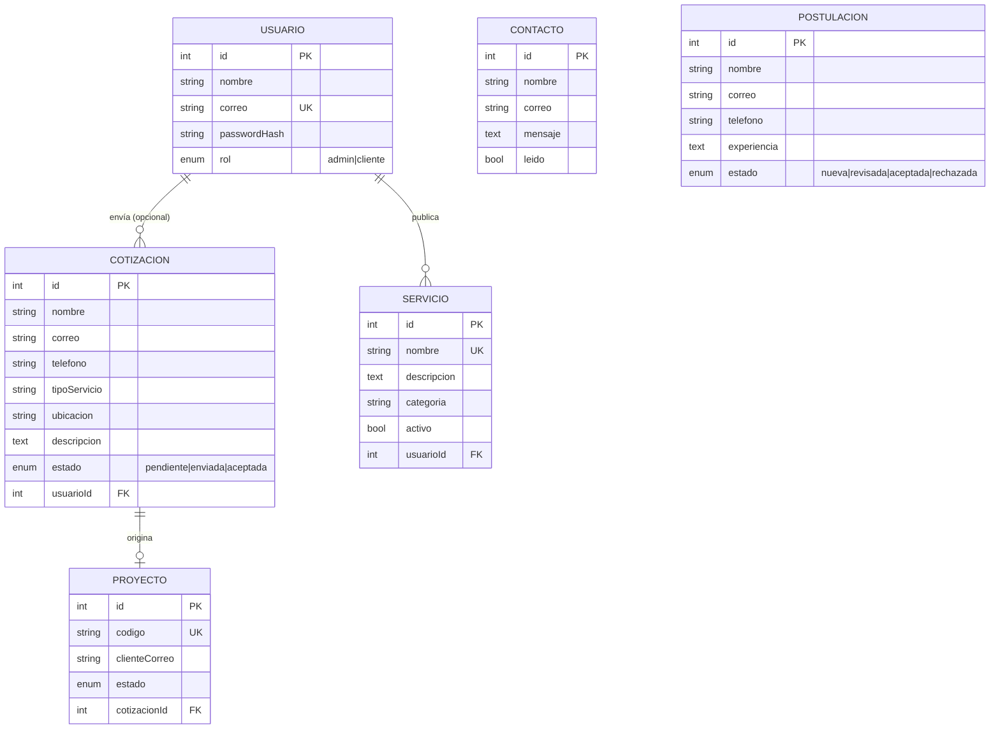

# OPV Drywall - API (backend)

API REST del Sprint de backend. Stack: **TypeScript + Node.js + Express + Sequelize + MySQL (mysql2)**, validación con **express-validator**,
autenticación **JWT + bcrypt**, logs con **morgan** y recarga automática con **nodemon** (ejecuta `ts-node`).

## Requisitos
- Node.js 18 o superior
- MySQL 8 (o MariaDB) encendido. La base de datos se crea sola si no existe.

## Puesta en marcha

```bash
cd backend
npm install
copy .env.example .env        # Mac/Linux: cp .env.example .env
# editar .env: poner DB_USER y DB_PASSWORD de tu MySQL
npm run seed                  # crea tablas, el usuario admin y los 6 servicios
npm run dev                   # http://localhost:3000  (nodemon + ts-node + morgan)
```

Scripts: `dev` (desarrollo con recarga), `build` (compila TypeScript a `dist/`), `start` (corre lo compilado, `node dist/server.js`),
`seed` (datos iniciales) y `typecheck` (revisa tipos sin compilar).

Comprobar: http://localhost:3000/api/salud -> `{"ok":true,...}`

Administrador de prueba (cambiar antes de publicar): `admin@opvdrywall.com` / `Admin123!`

Las credenciales se leen **solo** de `.env` (que está en `.gitignore`); en el repositorio solo se sube `.env.example`.

## Estructura

```
backend/src/
├── config/        database.ts              (conexión Sequelize/MySQL desde .env)
├── models/        Usuario, Cotizacion, Servicio, Contacto, Postulacion, Proyecto, index.ts (carga modelos y relaciones)
├── validators/    reglas de express-validator por módulo
├── middlewares/   auth.ts, validar.ts, errorHandler.ts
├── controllers/   lógica de cada módulo
├── routes/        endpoints de cada módulo
├── utils/         crudFactory.ts, ApiError.ts, asyncHandler.ts
├── types/         express.d.ts (agrega req.user al tipo Request)
├── app.ts  server.ts  seed.ts

backend/ tsconfig.json  nodemon.json  package.json  .env.example
```

Flujo de una petición: `ruta → auth/permisos → validators → validar (400) → controlador → modelo (Sequelize)`.
Los errores terminan siempre en `errorHandler.ts`.

## Modelo de datos



## Endpoints

Rutas protegidas: `Authorization: Bearer <token>` (se obtiene en `/api/auth/login`).
Los listados aceptan `?pagina=1&limite=20` y devuelven `{ total, pagina, limite, datos: [...] }`.

| Módulo | Método y ruta | Acceso | Historia |
|---|---|---|---|
| Auth | `POST /api/auth/registro` | Público | PB-06 |
| Auth | `POST /api/auth/login` | Público | PB-06 |
| Auth | `GET /api/auth/me` | Logueado | PB-06 |
| Usuarios | `GET /api/usuarios` · `GET /:id` · `POST` · `PUT /:id` · `DELETE /:id` | Admin | PB-06 |
| Cotizaciones | `POST /api/cotizaciones` | Público | PB-01 |
| Cotizaciones | `GET /api/cotizaciones?estado=` · `GET /:id` | Admin | PB-02 |
| Cotizaciones | `PUT /:id` · `PATCH /:id/estado` · `DELETE /:id` | Admin | PB-02 |
| Cotizaciones | `GET /api/cotizaciones/mias` | Logueado | PB-01 |
| Servicios | `GET /api/servicios?activo=&categoria=` · `GET /:id` | Público | PB-03 |
| Servicios | `POST` · `PUT /:id` · `DELETE /:id` | Admin | PB-04 |
| Contacto | `POST /api/contacto` | Público | - |
| Contacto | `GET` · `GET /:id` · `PUT /:id` · `DELETE /:id` | Admin | PB-02 |
| Postulaciones | `POST /api/postulaciones` | Público | PB-09 |
| Postulaciones | `GET?estado=` · `GET /:id` · `PUT /:id` · `PATCH /:id/estado` · `DELETE /:id` | Admin | PB-09 |
| Postulaciones | `GET /api/postulaciones/:id/cv` (descarga el CV adjunto) | Admin | PB-09 |
| Proyectos | `POST /api/proyectos/consulta` (correo + código) | Público | PB-07 |
| Proyectos | `GET` · `GET /:id` · `POST` · `PUT /:id` · `DELETE /:id` | Admin | PB-07 |

### Respuesta de error de validación (400)

```json
{
  "error": "Datos inválidos",
  "errores": [
    { "campo": "telefono", "ubicacion": "body", "mensaje": "telefono debe tener entre 8 y 10 dígitos" }
  ]
}
```

### Códigos HTTP
`200` OK · `201` creado · `400` datos inválidos · `401` no autenticado · `403` sin permiso · `404` no encontrado · `409` duplicado (ej. correo ya registrado) · `500` error interno

### Ejemplo: crear cotización

```http
POST /api/cotizaciones
Content-Type: application/json

{ "nombre": "Ana Pérez", "correo": "ana@mail.com", "telefono": "99887766",
  "tipoServicio": "Paneles de Yeso", "ubicacion": "Tegucigalpa", "descripcion": "Sala de 20 m2" }
```

## Subida de archivos

La API acepta archivos con `multipart/form-data` (librería **multer**). Si no se envía archivo, las rutas siguen funcionando con JSON como antes.

| Dónde | Campo de archivo | Formatos | Visibilidad |
|---|---|---|---|
| `POST` y `PUT /api/servicios` (admin) | `imagen` | `.jpg`, `.png`, `.webp` | **Pública**: queda en `/uploads/imagenes/<archivo>` |
| `POST` (público) y `PUT /api/postulaciones` (admin) | `cv` | `.pdf`, `.doc`, `.docx` | **Privada**: solo el admin la descarga con `GET /api/postulaciones/:id/cv` |

- **Tamaño máximo:** 5 MB por archivo (cambia con `MAX_UPLOAD_MB` en `.env`). Si se supera responde **413**.
- **Seguridad:** se valida el tipo declarado *y* los primeros bytes reales del archivo; el nombre se genera aleatorio (nunca se usa el del cliente); SVG y HTML no se aceptan.
- **Sin archivos huérfanos:** si la petición falla (validación, duplicado, 404...) el archivo subido se borra; al reemplazar o eliminar un registro también se borra el archivo anterior.
- **Dónde se guardan:** `backend/uploads/` (ignorada por Git). Con `UPLOADS_DIR` en `.env` se puede mover a otra ruta.
- **Base de datos:** se agregaron `servicios.imagen` y `postulaciones.cv`. Al iniciar (`npm run dev` o `npm run seed`) se crean solas si no existen, no hace falta `ALTER TABLE`. La respuesta de una postulación incluye `cv` (nombre interno) y `cvUrl` (ruta de descarga).
- **Producción:** en hostings con disco temporal (p. ej. el plan gratuito de Render) los archivos se pierden en cada despliegue. Usa un disco persistente (`UPLOADS_DIR`) o un almacenamiento externo como Cloudinary o S3.

### Ejemplos

```bash
# Postulación con CV (público)
curl -X POST http://localhost:3000/api/postulaciones \
  -F nombre="Ana Pérez" -F correo=ana@mail.com -F telefono=99887766 \
  -F "cv=@/ruta/mi-cv.pdf"

# Servicio con imagen (admin)
curl -X POST http://localhost:3000/api/servicios -H "Authorization: Bearer <token>" \
  -F nombre="Pintura" -F descripcion="Pintura interior" -F categoria=acabados \
  -F "imagen=@/ruta/foto.jpg"
```

En Postman: **Body → form-data**, los campos de texto como *Text* y `cv` / `imagen` cambiados a tipo *File*. No pongas el header `Content-Type` a mano.

En el frontend, con `FormData` y **sin** poner `Content-Type` (el navegador agrega el boundary):

```ts
const datos = new FormData(formulario); // <input type="file" name="cv" accept=".pdf,.doc,.docx">
await fetch(`${API_URL}/api/postulaciones`, { method: 'POST', body: datos });
```

## Pruebas con Postman

1. Importar `postman/OPV-Drywall-API.postman_collection.json`.
2. Con el servidor corriendo y tras `npm run seed`, ejecutar la colección completa (Runner).
3. Incluye 82 peticiones y 115 aserciones: CRUD de todos los módulos, validaciones 400, 401, 403, 404 y 409.
   Se puede ejecutar varias veces seguidas.

## Problemas comunes
- `ECONNREFUSED`: MySQL no está encendido o `DB_HOST`/`DB_PORT` son incorrectos.
- `Access denied for user`: revisar `DB_USER` y `DB_PASSWORD` en `.env`.
- `Falta JWT_SECRET`: copiar `.env.example` a `.env`.

## Nota de estructura
Además de `config/ models/ validators/ middlewares/ controllers/ routes/ utils/`, existe `src/seeds/` (`01-admin.seed.ts`, `02-servicios.seed.ts`, ejecutados en orden por `npm run seed`). Modelos y rutas (`*.routes.ts`) se cargan automáticamente, no hay que registrarlos a mano.
