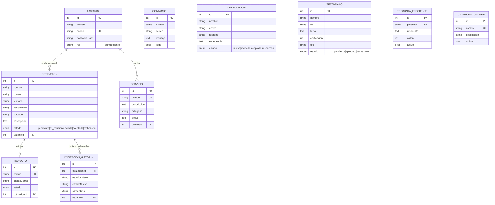

# OPV Drywall - API (backend)

API REST del Sprint de backend. Stack: **TypeScript + Node.js + Express + Sequelize + MySQL (mysql2)**, validación con **express-validator**,
autenticación **Passport (estrategia JWT) + bcrypt**, subida de archivos con **multer**, correos con **nodemailer**, documentación con **Swagger**,
logs con **morgan** y recarga automática con **nodemon** (ejecuta `ts-node`).

## Requisitos
- Node.js 18 o superior
- MySQL 8 (o MariaDB) encendido. La base de datos se crea sola si no existe.

## Puesta en marcha

```bash
cd backend
npm install
copy .env.example .env        # Mac/Linux: cp .env.example .env
# editar .env: poner DB_USER y DB_PASSWORD de tu MySQL
npm run seed                  # crea tablas, el usuario admin, servicios, categorías, preguntas y testimonios
npm run dev                   # http://localhost:3000  (nodemon + ts-node + morgan)
```

Scripts: `dev` (desarrollo con recarga), `build` (compila TypeScript a `dist/`), `start` (corre lo compilado, `node dist/server.js`),
`seed` (datos iniciales), `typecheck` (revisa tipos sin compilar) y `docs:check` (comprueba que **todas** las rutas estén en Swagger).

Comprobar: http://localhost:3000/api/salud -> `{"ok":true,...}`

Administrador de prueba (cambiar antes de publicar): `admin@opvdrywall.com` / `Admin123!`

Las credenciales se leen **solo** de `.env` (que está en `.gitignore`); en el repositorio solo se sube `.env.example`.

## Estructura

```
backend/src/
├── config/        database.ts (conexión MySQL), passport.ts (estrategia JWT), swagger.ts, columnas.ts (actualiza bases viejas)
├── models/        Usuario, Cotizacion, CotizacionHistorial, Servicio, Contacto, Postulacion, Proyecto,
│                  Testimonio, PreguntaFrecuente, CategoriaGaleria, index.ts (carga modelos y relaciones)
├── validators/    reglas de express-validator por módulo
├── middlewares/   auth.ts (Passport), validar.ts, errorHandler.ts, subida.ts (multer), limitador.ts (límite de peticiones)
├── controllers/   lógica de cada módulo
├── routes/        endpoints de cada módulo (con su documentación Swagger)
├── utils/         crudFactory.ts, ApiError.ts, asyncHandler.ts, correo.ts, plantillas.ts, notificaciones.ts
├── scripts/       verificar-swagger.ts     (npm run docs:check)
├── types/         express.d.ts (agrega req.user al tipo Request)
├── app.ts  server.ts  seed.ts

backend/ tsconfig.json  nodemon.json  package.json  .env.example
```

Flujo de una petición: `ruta → auth/permisos → validators → validar (400) → controlador → modelo (Sequelize)`.
Los errores terminan siempre en `errorHandler.ts`.

## Modelo de datos



## Endpoints

Rutas protegidas: `Authorization: Bearer <token>` (se obtiene en `/api/auth/login`).
Los listados aceptan `?pagina=1&limite=20` y devuelven `{ total, pagina, limite, datos: [...] }`
(además: búsqueda, rango de fechas y orden, ver [Listados](#listados-búsqueda-fechas-y-orden)).

| Módulo | Método y ruta | Acceso | Historia |
|---|---|---|---|
| Auth | `POST /api/auth/registro` | Público | PB-06 |
| Auth | `POST /api/auth/login` | Público | PB-06 |
| Auth | `GET /api/auth/me` | Logueado | PB-06 |
| Auth | `PUT /api/auth/password` (cambiar mi contraseña) | Logueado | PB-06 |
| Auth | `POST /api/auth/olvide-password` · `POST /api/auth/restablecer-password` | Público | PB-06 |
| Usuarios | `GET /api/usuarios` · `GET /:id` · `POST` · `PUT /:id` · `DELETE /:id` | Admin | PB-06 |
| Cotizaciones | `POST /api/cotizaciones` | Público | PB-01 |
| Cotizaciones | `GET /api/cotizaciones?estado=` · `GET /:id` | Admin | PB-02 |
| Cotizaciones | `PUT /:id` (datos) · `DELETE /:id` | Admin | PB-02 |
| Cotizaciones | `PATCH /:id/estado` (con transacción e historial) · `GET /:id/historial` | Admin | PB-02 |
| Cotizaciones | `GET /api/cotizaciones/mias` | Logueado | PB-01 |
| Servicios | `GET /api/servicios?activo=&categoria=` · `GET /:id` | Público | PB-03 |
| Servicios | `POST` · `PUT /:id` · `DELETE /:id` | Admin | PB-04 |
| Contacto | `POST /api/contacto` | Público | - |
| Contacto | `GET` · `GET /:id` · `PUT /:id` · `DELETE /:id` | Admin | PB-02 |
| Postulaciones | `POST /api/postulaciones` | Público | PB-09 |
| Postulaciones | `GET?estado=` · `GET /:id` · `PUT /:id` · `PATCH /:id/estado` · `DELETE /:id` | Admin | PB-09 |
| Postulaciones | `GET /api/postulaciones/:id/cv` (descarga el CV adjunto) | Admin | PB-09 |
| Proyectos | `POST /api/proyectos/consulta` (correo + código) | Público | PB-07 |
| Proyectos | `GET` · `GET /:id` · `POST` · `PUT /:id` · `DELETE /:id` | Admin | PB-07 |
| Testimonios | `GET /api/testimonios` · `GET /:id` (solo aprobados) · `POST` (queda pendiente) | Público | - |
| Testimonios | `GET` (todos, `?estado=`) · `PUT /:id` · `PATCH /:id/estado` · `DELETE /:id` | Admin | - |
| Preguntas frecuentes | `GET /api/preguntas-frecuentes` · `GET /:id` (solo activas) | Público | - |
| Preguntas frecuentes | `POST` · `PUT /:id` · `DELETE /:id` | Admin | - |
| Categorías de galería | `GET /api/categorias-galeria` · `GET /:id` (solo activas) | Público | - |
| Categorías de galería | `POST` · `PUT /:id` · `DELETE /:id` | Admin | - |
| Reportes | `GET /api/reportes/resumen` · `/cotizaciones-por-mes?meses=6` · `/cotizaciones-por-servicio` | Admin | - |

### Respuesta de error de validación (400)

```json
{
  "error": "Datos inválidos",
  "errores": [
    { "campo": "telefono", "ubicacion": "body", "mensaje": "telefono debe tener entre 8 y 10 dígitos" }
  ]
}
```

### Códigos HTTP
`200` OK · `201` creado · `400` datos inválidos · `401` no autenticado o token vencido · `403` sin permiso · `404` no encontrado · `409` duplicado o cambio no permitido · `413` archivo demasiado grande · `429` demasiadas peticiones · `500` error interno

### Ejemplo: crear cotización

```http
POST /api/cotizaciones
Content-Type: application/json

{ "nombre": "Ana Pérez", "correo": "ana@mail.com", "telefono": "99887766",
  "tipoServicio": "Paneles de Yeso", "ubicacion": "Tegucigalpa", "descripcion": "Sala de 20 m2" }
```

## Seguridad (Passport + JWT)

- **Passport** con la estrategia `jwt` (`config/passport.ts`): lee `Authorization: Bearer <token>`, verifica firma (solo `HS256`) y vencimiento, y confirma que el usuario **todavía existe**; el rol se toma de la base de datos, así que si a alguien le quitan el rol, el cambio vale de inmediato.
- **El token solo lleva `id` y `rol`** (nada de correo, nombre ni hash). Dura `JWT_EXPIRES_IN` (por defecto `8h`).
- **Respuestas claras:** `401` sin token / token inválido / `"Tu sesión expiró"`, y `403` cuando el usuario está autenticado pero no tiene el rol. Rutas públicas con sesión opcional usan `authOpcional`.
- **Contraseñas:** guardadas con `bcrypt` (nunca se devuelven). El login responde igual si falla el correo o la clave.
- **Recuperar contraseña:** `POST /auth/olvide-password` siempre responde lo mismo (no revela qué correos existen) y manda un enlace por correo; el enlace **vence en 30 minutos y sirve una sola vez** (el token se firma con el hash actual de la contraseña). La página que lo recibe debe existir en `FRONTEND_URL/html/restablecer.html?token=...` y llamar a `POST /auth/restablecer-password`.
- **Límite de intentos por IP:** login/registro/recuperación (20 cada 15 min) y formularios públicos (30 cada 15 min); al pasarse responde `429`. Se ajusta con `RATE_LIMIT_AUTH_MAX` y `RATE_LIMIT_PUBLIC_MAX`.
- **CORS:** solo los sitios de `CORS_ORIGINS` (`.env`) pueden llamar a la API desde el navegador. Para GitHub Pages el valor es `https://danzela1.github.io` (sin barra al final).

## Cotizaciones: estados, historial y transacciones

Estados: `pendiente`, `en_revision`, `enviada`, `aceptada`, `rechazada`. Flujo permitido:

```
pendiente -> en_revision | enviada | rechazada
en_revision -> enviada | rechazada
enviada -> aceptada | rechazada
rechazada -> pendiente (reabrir)        aceptada es final
```

- `PATCH /api/cotizaciones/:id/estado` `{ "estado": "en_revision", "comentario": "..." }` corre en **una transacción**: bloquea la fila (`FOR UPDATE`, así dos admins no la cambian a la vez), valida el flujo, actualiza el estado y escribe la fila de `cotizacion_historial`. Si algo falla hace **ROLLBACK** y no queda nada a medias. Un cambio no permitido responde `409`.
- `POST /api/cotizaciones` también es transaccional: guarda la cotización y su primera fila de historial juntas.
- El estado **ya no se cambia con `PUT`**: solo con el `PATCH`, para que nunca se salte el historial.
- `GET /api/cotizaciones/:id/historial` devuelve la línea de tiempo (de qué estado a cuál, quién y cuándo).
- Al cambiar el estado, el cliente recibe un correo. Las bases de datos creadas antes se actualizan solas al iniciar (se amplía el `ENUM`), no hace falta `ALTER TABLE`.

## Listados: búsqueda, fechas y orden

Todos los listados (`cotizaciones`, `contacto`, `postulaciones`, `proyectos`, `usuarios`, `servicios`, `testimonios`, `preguntas-frecuentes`, `categorias-galeria`) aceptan:

| Parámetro | Ejemplo | Qué hace |
|---|---|---|
| `pagina`, `limite` | `?pagina=2&limite=10` | Paginación (límite máximo 100) |
| `q` | `?q=carlos` | Busca texto parcial en los campos principales del módulo |
| `desde`, `hasta` | `?desde=2026-11-01&hasta=2026-11-30` | Rango de fecha de creación (`hasta` incluye todo ese día) |
| `ordenarPor`, `dir` | `?ordenarPor=nombre&dir=desc` | Orden por una columna permitida (`asc` o `desc`) |
| filtros propios | `?estado=pendiente` | Cada módulo tiene los suyos (ver Swagger) |

## Correos (nodemailer)

- Los correos salen **en segundo plano**: la API responde de inmediato y **nunca** falla porque el correo falle (SMTP caído, credenciales malas...). El error solo se registra en la consola.
- Tienen versión HTML con diseño y versión de texto, y todo lo que escribe un usuario se escapa para evitar inyección de código.
- Se envían: bienvenida al registrarse, recuperación y cambio de contraseña, confirmación y aviso de nueva cotización, cambio de estado de cotización, aviso al admin de mensajes de contacto y de testimonios nuevos.
- Si faltan `SMTP_HOST`, `SMTP_USER` o `SMTP_PASS` en `.env`, no se envía nada y la consola lo avisa. Plantillas en `utils/plantillas.ts`, mensajes en `utils/notificaciones.ts`.
- Gmail: usa una **contraseña de aplicación** de 16 letras (Cuenta de Google → Seguridad → Verificación en dos pasos → Contraseñas de aplicaciones).

## Testimonios, preguntas frecuentes y categorías de galería

- **Testimonios:** cualquiera puede enviar uno (`POST`, con foto opcional en el campo `foto`), pero nace `pendiente` y **no se publica** hasta que un admin lo aprueba con `PATCH /:id/estado`. Los visitantes solo ven los aprobados y sin datos privados (correo, estado).
- **Preguntas frecuentes** y **categorías de galería:** los visitantes solo ven las activas y el admin las gestiona. Las preguntas se ordenan por el campo `orden`.
- `npm run seed` carga los 6 servicios, 6 categorías (una por servicio), 6 preguntas y los 4 testimonios del sitio. Los textos de las preguntas están redactados con las ideas del sitio: ajústalos desde Swagger para que coincidan palabra por palabra.

## Subida de archivos

La API acepta archivos con `multipart/form-data` (librería **multer**). Si no se envía archivo, las rutas siguen funcionando con JSON como antes.

| Dónde | Campo de archivo | Formatos | Visibilidad |
|---|---|---|---|
| `POST` y `PUT /api/servicios` (admin) | `imagen` | `.jpg`, `.png`, `.webp` | **Pública**: queda en `/uploads/imagenes/<archivo>` |
| `POST` (público) y `PUT /api/testimonios` (admin) | `foto` | `.jpg`, `.png`, `.webp` | **Pública**: queda en `/uploads/testimonios/<archivo>` |
| `POST` (público) y `PUT /api/postulaciones` (admin) | `cv` | `.pdf`, `.doc`, `.docx` | **Privada**: solo el admin la descarga con `GET /api/postulaciones/:id/cv` |

- **Tamaño máximo:** 5 MB por archivo (cambia con `MAX_UPLOAD_MB` en `.env`). Si se supera responde **413**; un campo de archivo equivocado o más de un archivo responde **400** (nunca un 500).
- **Orden:** una carpeta por tipo (`imagenes/`, `testimonios/`, `cv/`) y nombres únicos `fecha-aleatorio.ext`.
- **Seguridad:** se valida el tipo declarado *y* los primeros bytes reales del archivo; el nombre se genera aleatorio (nunca se usa el del cliente); SVG y HTML no se aceptan.
- **Sin archivos huérfanos:** si la petición falla (validación, duplicado, 404...) el archivo subido se borra; al reemplazar o eliminar un registro también se borra el archivo anterior.
- **Dónde se guardan:** `backend/uploads/` (ignorada por Git). Con `UPLOADS_DIR` en `.env` se puede mover a otra ruta.
- **Base de datos:** se agregaron `servicios.imagen` y `postulaciones.cv`. Al iniciar (`npm run dev` o `npm run seed`) se crean solas si no existen, no hace falta `ALTER TABLE`. La respuesta de una postulación incluye `cv` (nombre interno) y `cvUrl` (ruta de descarga).
- **Producción:** en hostings con disco temporal (p. ej. el plan gratuito de Render) los archivos se pierden en cada despliegue. Usa un disco persistente (`UPLOADS_DIR`) o un almacenamiento externo como Cloudinary o S3.

### Ejemplos

```bash
# Postulación con CV (público)
curl -X POST http://localhost:3000/api/postulaciones \
  -F nombre="Ana Pérez" -F correo=ana@mail.com -F telefono=99887766 \
  -F "cv=@/ruta/mi-cv.pdf"

# Servicio con imagen (admin)
curl -X POST http://localhost:3000/api/servicios -H "Authorization: Bearer <token>" \
  -F nombre="Pintura" -F descripcion="Pintura interior" -F categoria=acabados \
  -F "imagen=@/ruta/foto.jpg"
```

En el frontend, con `FormData` y **sin** poner `Content-Type` (el navegador agrega el boundary):

```ts
const datos = new FormData(formulario); // <input type="file" name="cv" accept=".pdf,.doc,.docx">
await fetch(`${API_URL}/api/postulaciones`, { method: 'POST', body: datos });
```

## Documentación y pruebas con Swagger

1. Con el servidor corriendo, abrir http://localhost:3000/api-docs
2. Para las rutas protegidas: hacer `POST /api/auth/login` (tras `npm run seed`), copiar el `token`, pulsar **Authorize** y pegarlo.
3. Probar cada endpoint con **Try it out**: CRUD de todos los módulos y respuestas 400, 401, 403, 404 y 409.
4. Los endpoints con archivos (`imagen`, `foto`, `cv`) están documentados como `multipart/form-data`: en **Try it out** aparece el botón para elegir el archivo.
5. Todas las respuestas de error (400, 401, 403, 404, 409, 413, 429, 500) tienen su esquema `{ "error": "..." }`. La especificación en JSON está en http://localhost:3000/api-docs.json.
6. `npm run docs:check` compara las rutas de Express con las de Swagger y falla si falta alguna: córrelo antes de cada pull request.

## Problemas comunes
- `ECONNREFUSED`: MySQL no está encendido o `DB_HOST`/`DB_PORT` son incorrectos.
- `Access denied for user`: revisar `DB_USER` y `DB_PASSWORD` en `.env`.
- `Falta JWT_SECRET`: copiar `.env.example` a `.env`.
- El formulario de GitHub Pages da error de CORS: revisa que `CORS_ORIGINS` en `.env` tenga `https://danzela1.github.io` (con **l**, sin barra al final) y reinicia el servidor.
- `429`: demasiadas peticiones desde tu IP; espera 15 minutos o sube `RATE_LIMIT_AUTH_MAX` mientras pruebas.

## Nota de estructura
Además de `config/ models/ validators/ middlewares/ controllers/ routes/ utils/`, existe `src/seeds/` (`01-admin` a `05-testimonios`, ejecutados en orden por `npm run seed`). Modelos y rutas (`*.routes.ts`) se cargan automáticamente, no hay que registrarlos a mano.

## Clientes, materiales y cotización con detalle

| Módulo | Rutas | Acceso |
|---|---|---|
| Clientes | `/api/clientes` (CRUD). Se crean solos al cotizar (por correo) | Admin |
| Materiales | `/api/materiales` (CRUD, catálogo con precio) | Admin |
| Servicios | ahora con `precioBase` (solo lo ve el admin) | — |
| Cotizaciones | `POST /api/cotizaciones/con-detalle` · `GET /:id` ahora trae cliente y detalle | Admin |

**Transacción de varios modelos — `POST /api/cotizaciones/con-detalle`:** Cliente (buscar o crear) → Cotización → líneas de detalle → montos → historial, todo en una sola transacción. Un ítem inválido (ej. un material que no existe) deshace todo, incluido el cliente nuevo. Los precios del catálogo se copian al detalle; el impuesto es `IMPUESTO_PORCENTAJE` (15 por defecto) y se omite con `aplicarImpuesto: false`.
Las columnas nuevas en bases ya creadas se agregan solas (`config/columnas.ts`).
